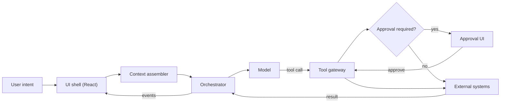
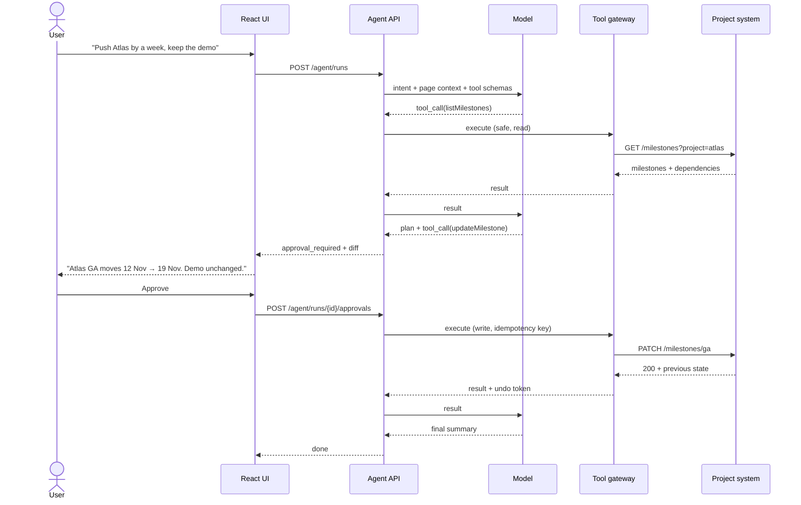
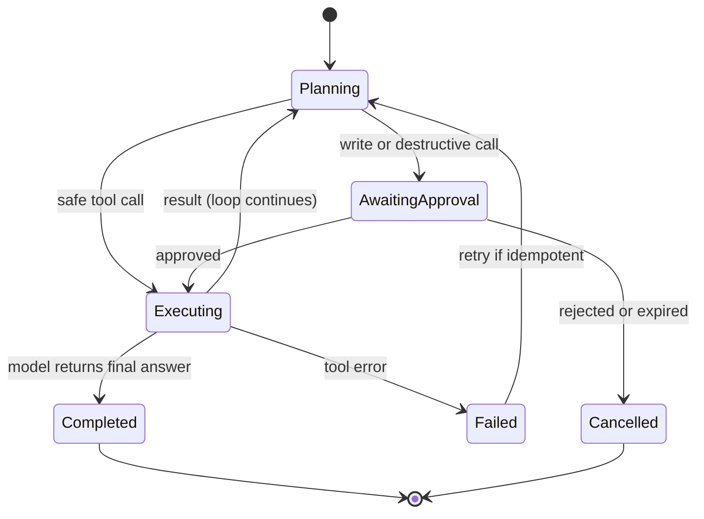
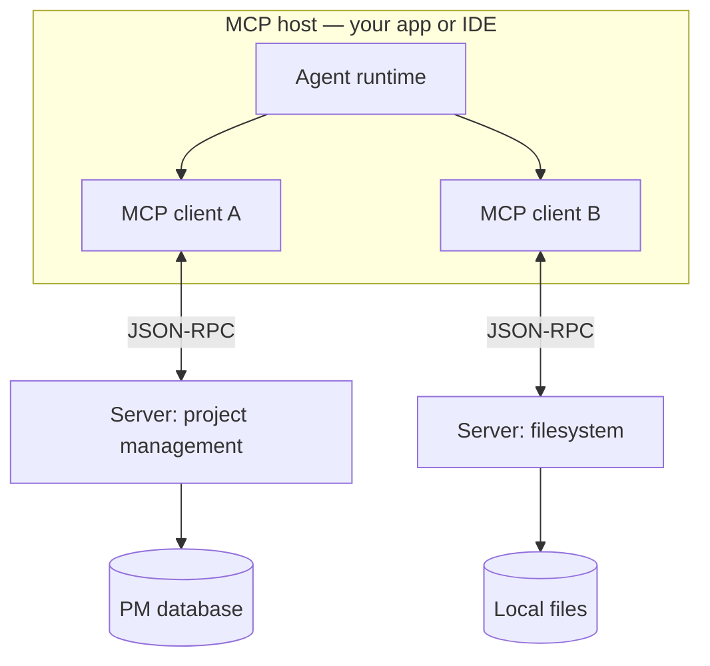

Here is a request that breaks most dashboards: *find every invoice that failed twice this week, re-run them, and ask me before you touch anything over fifty thousand rupees.*

A traditional UI cannot accept that sentence. It can accept a filter, a selection, a bulk action, and a confirmation dialog — four primitives that the user has to know exist and assemble in the right order. The sentence is a goal. The dashboard is a set of verbs. The distance between those two is the entire argument for agentic UI.

We are not talking about a chat box bolted onto a sidebar. The interesting shift is structural: the interface stops being a menu of things you can do and becomes a runtime that can plan, call tools, and act on your behalf — with a checkpoint where a human still says yes.

I want to be precise about what is real here, because this is a space where a weekend demo and a production system look identical in a screenshot. So I'll separate the parts I would ship from the parts I would not, and mark the places where the ecosystem is still moving.

## What "agentic" actually means

Three things get called AI UI, and conflating them is why the discourse is a mess.

| | Traditional UI | Chatbot | Agentic UI |
|---|---|---|---|
| **Input** | Clicks, forms, commands | Questions | Goals, in natural language |
| **Output** | Deterministic screen state | Prose | Prose plus real actions |
| **Control** | User drives every step | User reads, then acts manually | System plans and acts, user approves |
| **Failure mode** | Wrong button, wrong data | Confidently wrong answer | Wrong action, taken at scale |
| **Trust comes from** | Predictability | Nothing much | Reversibility and oversight |

A chatbot answers. An agent acts. The difference is not the language model — it is the loop: *observe context, propose a plan, call a tool, read the result, decide what to do next.* Remove the tools and you have autocomplete with manners. Remove the approval gate and you have a script with a language model attached, and nobody wants to be the person who explains that to legal.

There is a useful ladder here, and most products are on the second rung:

1. **Answer** — retrieve and summarise. Read-only, low risk, already common.
2. **Suggest** — propose an action, pre-fill a form, highlight a record. Still human-executed.
3. **Act with approval** — the system prepares and stages a change; a human approves the effect.
4. **Act within policy** — autonomous, but only inside a narrow, pre-declared envelope with spend and blast-radius limits.

Rung four is where the interesting engineering is, and where almost nobody should start. The jump from three to four is not a model upgrade. It is an authorization, auditing and rollback problem wearing an AI costume.

## The architecture of an interface that acts

Every credible design I have seen has the same six parts. The names vary; the boundaries do not.



**The UI shell** renders state and collects consent. It holds no credentials, executes no tools, and — this matters — makes no authorization decisions. Anything the browser decides can be replayed by the browser.

**The context assembler** decides what the model sees. Current page, selected record, the user's role, the last few turns, a summary of older history, and a hard token budget. This layer is where most quality lives. A model with the wrong context is not a reasoning problem; it is a plumbing problem, and no prompt fixes it.

**The orchestrator** runs the loop: call the model, validate its output, execute or queue tools, feed results back, stop on success, budget exhaustion, or a step cap. It is a state machine, not a `while (true)`. It also owns persistence, so a run survives a page refresh.

**The model** is a stateless function with a schema. It proposes. It never executes. That sentence should be in your architecture doc, because half the bad designs I have reviewed assume the opposite.

**The tool gateway** is the only component that touches the outside world. It validates arguments, checks permissions against the acting user, enforces idempotency, writes an audit record, and returns a bounded result.

**The approval layer** is not a modal with an "OK" button. It is a server-side gate keyed to a specific tool call, with an expiry, a human's identity attached, and a record of what was approved.

One rule holds the whole thing together: **the model proposes, the gateway disposes.** If a single component both decides and executes, you have built a very fast way to lose data.

## A run, end to end

Take a project management tool. The milestone view is open. A user types: *"Push the Atlas launch by a week, but keep the customer demo on the original date."*



Notice what the model did not do. It did not touch the database. It did not decide that the user is allowed to edit milestones — the gateway checked that against the real session. It did not compute the new date reliably either; dates are arithmetic, and arithmetic belongs in a tool. Ask a language model to add seven days to a date and it will usually be right, which is worse than always being wrong, because "usually" is how you get a milestone landing on a Sunday.

The orchestrator's state machine is the actual contract:



Every arrow is a place where you need persistence, a timeout, and an audit entry. That is the unglamorous 80% of this work.

## The API between the two halves

The client and the agent runtime talk over a stream. I use newline-delimited JSON rather than SSE for one reason: SSE requires each payload to be a string, so structured events end up double-encoded. NDJSON over a `fetch` stream is smaller and simpler to parse.

```http
POST /api/agent/runs
Content-Type: application/json

{
  "intent": "Push the Atlas launch by a week, keep the demo",
  "threadId": "th_9f2c",
  "context": { "route": "/projects/atlas", "selectedId": "ms_ga" }
}
```

```http
HTTP/1.1 200 OK
Content-Type: application/x-ndjson

{"type":"plan","steps":[{"id":"s1","label":"Read Atlas milestones","status":"running"}]}
{"type":"tool_call","callId":"tc_1","name":"listMilestones","args":{"project":"atlas"}}
{"type":"tool_result","callId":"tc_1","ok":true,"data":{"milestones":["..."]}}
{"type":"approval_required","callId":"tc_2","preview":{"tool":"updateMilestone","effect":"Atlas GA: 2026-11-12 → 2026-11-19","risk":"write"}}
```

```http
POST /api/agent/runs/run_771/approvals
Content-Type: application/json

{ "callId": "tc_2", "decision": "approve" }
```

Two details that are easy to get wrong. The approval is keyed to `callId`, not to the run, so approving one write cannot be replayed to authorise a different one. And the run id is server-generated and bound to the session — never trust a client-supplied approval token.

## Building it in React and TypeScript

Start with the event model. If your event types are loose, every component becomes a `switch` on strings and the whole thing rots in a month.

```ts
// agent-events.ts
export type PlanStep = {
  id: string
  label: string
  status: 'pending' | 'running' | 'done' | 'failed'
}

export type ApprovalPreview = {
  tool: string
  effect: string
  risk: 'read' | 'write' | 'destructive'
  diff?: string
  expiresAt: string
}

export type AgentEvent =
  | { type: 'token'; text: string }
  | { type: 'plan'; steps: PlanStep[] }
  | { type: 'step'; id: string; status: PlanStep['status'] }
  | { type: 'tool_call'; callId: string; name: string; args: unknown }
  | { type: 'tool_result'; callId: string; ok: boolean; data: unknown }
  | { type: 'approval_required'; callId: string; preview: ApprovalPreview }
  | { type: 'error'; code: string; message: string; retryable: boolean }
  | { type: 'done'; runId: string }
```

A discriminated union here buys you exhaustiveness checking. When the backend adds `'clarification_required'` — and it will — the compiler tells you every place that needs to handle it. That is worth more than any amount of prompt tuning.

The transport is a small hook. Note the buffer: chunks split mid-line all the time, and a naive `JSON.parse` on each chunk will fail in production and never in your test.

```ts
// use-agent-run.ts
import { useCallback, useReducer, useRef } from 'react'

type State = {
  status: 'idle' | 'running' | 'awaiting_approval' | 'done' | 'error'
  steps: PlanStep[]
  messages: { role: 'user' | 'assistant'; text: string }[]
  approval?: { callId: string; preview: ApprovalPreview }
  error?: { code: string; message: string }
}

export function useAgentRun() {
  const [state, dispatch] = useReducer(reducer, initialState)
  const abortRef = useRef<AbortController | null>(null)

  const start = useCallback(async (intent: string) => {
    abortRef.current?.abort()
    const controller = new AbortController()
    abortRef.current = controller

    const res = await fetch('/api/agent/runs', {
      method: 'POST',
      headers: { 'content-type': 'application/json' },
      body: JSON.stringify({ intent }),
      signal: controller.signal,
    })

    if (!res.ok || !res.body) {
      dispatch({ type: 'failed', code: `http_${res.status}` })
      return
    }

    const reader = res.body.pipeThrough(new TextDecoderStream()).getReader()
    let buffer = ''

    while (true) {
      const { value, done } = await reader.read()
      if (done) break

      buffer += value
      const lines = buffer.split('\n')
      buffer = lines.pop() ?? '' // keep the partial line

      for (const line of lines) {
        if (!line.trim()) continue
        dispatch({ type: 'event', event: JSON.parse(line) as AgentEvent })
      }
    }
  }, [])

  const decide = useCallback(async (callId: string, decision: 'approve' | 'reject') => {
    await fetch(`/api/agent/approvals`, {
      method: 'POST',
      headers: { 'content-type': 'application/json' },
      body: JSON.stringify({ callId, decision }),
    })
  }, [])

  const cancel = useCallback(() => abortRef.current?.abort(), [])

  return { state, start, decide, cancel }
}
```

**What is real here:** the reducer, the buffering, and the abort handling are the same shape I have used in production. **What is missing:** reconnect-after-drop, run resumption by id, and backpressure. Those are three separate features, not three lines.

The approval card is where trust is won or lost. Show the effect, not the tool name. "Run `updateMilestone`" means nothing to a user; "Atlas GA moves 12 Nov → 19 Nov" means everything.

```tsx
export function ApprovalCard({
  callId,
  preview,
  onDecide,
}: {
  callId: string
  preview: ApprovalPreview
  onDecide: (callId: string, decision: 'approve' | 'reject') => void
}) {
  const [acknowledged, setAcknowledged] = useState(false)
  const destructive = preview.risk === 'destructive'

  return (
    <section className="approval" aria-labelledby={`approval-${callId}`}>
      <h3 id={`approval-${callId}`}>This needs your approval</h3>
      <p className="approval__effect">{preview.effect}</p>
      {preview.diff && <pre className="approval__diff">{preview.diff}</pre>}

      {destructive && (
        <label className="approval__ack">
          <input
            type="checkbox"
            checked={acknowledged}
            onChange={(e) => setAcknowledged(e.target.checked)}
          />
          I understand this cannot be undone
        </label>
      )}

      <div className="approval__actions">
        <button onClick={() => onDecide(callId, 'reject')}>Reject</button>
        <button
          disabled={destructive && !acknowledged}
          onClick={() => onDecide(callId, 'approve')}
        >
          Approve
        </button>
      </div>
    </section>
  )
}
```

The checkbox is deliberately not pre-checked. If every approval is one click, users stop reading by the third run — an actually measurable pattern in every confirmation flow ever shipped, from cookie banners to deploy buttons.

On the server, the tool gateway is where the model's output stops being special and becomes untrusted input:

```ts
// gateway.ts
export async function executeTool(call: ToolCall, ctx: RequestContext) {
  const tool = registry[call.name]
  if (!tool) throw new ToolError('unknown_tool', 400)

  // 1. Shape: the model can emit anything, including fields you never defined
  const args = tool.schema.parse(call.args)

  // 2. Permission: checked against the human's session, not the model's intent
  await authorize(ctx.actor, tool.scope, args)

  // 3. Consent: high-risk calls need an unexpired approval for this exact callId
  if (tool.risk !== 'read') {
    const approval = await approvals.find(call.callId)
    if (!approval || approval.actorId !== ctx.actor.id) {
      throw new ToolError('approval_required', 409)
    }
  }

  // 4. Idempotency: a retry must not create a second invoice
  return tool.run(args, {
    idempotencyKey: call.callId,
    actor: ctx.actor.id,
    signal: ctx.signal,
  })
}
```

Four checks, four failure modes, all boring on purpose. `schema.parse` is zod, valibot, or whatever you already use — the library does not matter. What matters is that the model's arguments are never passed through untouched.

## Streaming, timelines and generated components

A single spinner for a twenty-second run is a product failure. Users tolerate slow if they can see progress, and they do not tolerate opaque.

There are three streams, and they deserve three treatments:

- **Tokens** go into the message body, batched per animation frame.
- **Plan steps** go into a timeline, one row per step, with a status.
- **Tool events** go into the timeline too, but with a collapsed result payload.

Batching tokens matters more than it sounds. A naive implementation calls `setState` per token, which at fifty tokens a second means fifty renders a second of a growing string. Coalescing into `requestAnimationFrame` cuts that to display rate and makes the whole panel feel calmer.

```tsx
function Timeline({ steps }: { steps: PlanStep[] }) {
  return (
    <ol className="timeline">
      {steps.map((step) => (
        <li key={step.id} data-status={step.status}>
          <span className="timeline__dot" aria-hidden="true" />
          <span>{step.label}</span>
          <span className="visually-hidden">{statusLabel(step.status)}</span>
        </li>
      ))}
    </ol>
  )
}
```

Accessibility needs a decision here, not a library. Streaming text should not be announced token by token — screen readers will produce a stutter. Put `aria-live="polite"` on a separate, low-frequency status region ("Reading milestones", "Waiting for approval") and leave the transcript out of the live region entirely. The timeline above uses visually hidden status text precisely so that a step change is announced once, at the row level.

Now the controversial part: **dynamic components**. The tempting version lets the model emit JSX or HTML, which you then render. Do not do this. You have built a remote code execution feature and called it a design system.

The version that survives review is a descriptor plus an allowlisted registry:

```ts
// blocks.ts — the only things the model is allowed to render
export const blocks = {
  table: lazy(() => import('./blocks/DataTable')),
  chart: lazy(() => import('./blocks/Chart')),
  diff: lazy(() => import('./blocks/DiffView')),
} as const

export type BlockKind = keyof typeof blocks

export type BlockDescriptor = {
  kind: BlockKind
  title: string
  data: unknown // validated per-kind by the block, not by the model
}
```

```tsx
export function AgentBlock({ block }: { block: BlockDescriptor }) {
  const Component = blocks[block.kind]
  if (!Component) return null // unknown kind: render nothing, log it
  return (
    <Suspense fallback={<BlockSkeleton />}>
      <Component title={block.title} data={block.data} />
    </Suspense>
  )
}
```

The model chooses *which* of your components to show. It does not choose *what* they are made of. You keep the design system, the accessibility guarantees, the bundle boundaries, and the tests. You lose some novelty. That is the trade, and it is a good one.

I would go further: generate layout only in prototypes. In a product with more than one screen, an interface that rearranges itself per query is a support burden and an accessibility hazard, because the user's spatial memory is part of the interface.

## MCP: the integration layer, not the product

The Model Context Protocol is an open protocol for exposing tools, resources and prompts to a model host over JSON-RPC. Anthropic published it in late 2024, and it has since been adopted well beyond Anthropic's own products. The reason it matters to frontend engineers is mundane: without it, every agent integration is bespoke. With it, a project management system ships one MCP server and every compatible host can use it.



The three primitives are worth internalising:

- **Tools** are functions the model can call. They are the dangerous ones.
- **Resources** are readable context, addressed by URI. They are the safe ones.
- **Prompts** are reusable templates the user can invoke explicitly.

Transports have changed more than once — stdio for local servers, then HTTP with SSE, then Streamable HTTP. If you are building today, read the current specification rather than a blog post from a year ago, including this one. The auth story (OAuth-based flows for remote servers, and the warning against passing a client's token straight through to a third-party server) is the part most likely to have moved by the time you read it.

The honest assessment: MCP solves discovery and invocation. It does not solve authorization, data minimisation, or the fact that a tool's response can contain instructions. Those remain yours.

## What goes wrong, and what to do about it

**Prompt injection is the one that gets people.** Any text the model reads — an issue description, a PDF, an email, a tool result — can contain instructions. The dangerous combination is well known by now: private data, untrusted content, and an outbound channel. If a run has all three, an attacker who can write a ticket title can often make your agent exfiltrate something.

The mitigations are architectural, not lexical. Keep untrusted content labelled and out of the system prompt. Do not give a single run both broad read access and an unrestricted send capability. Put a human in front of anything that leaves the trust boundary. And log tool calls with their arguments, because "the agent did something weird" is unanswerable without a trace.

**Authorization is not a prompt.** Saying "only modify projects the user owns" in a system prompt is a suggestion. Checking `ctx.actor` against the project's ACL is a control. Every tool call re-checks; nothing is cached across users; scopes are per tool, short-lived, and never stored in the browser.

**Hallucinated arguments are normal.** The model will invent an ID that looks plausible. Schema validation catches shape; it does not catch meaning. Add preconditions to the tool itself: resolve the id, fail with a structured error, and let the loop recover. A tool that returns "project ms_ga not found" is a hundred times more useful than a 500.

**Idempotency and undo are features, not polish.** Every write takes a client-generated key so a retry cannot double-apply. Where the domain allows it, capture the previous state and offer an undo for a bounded window. The ability to reverse an action changes the risk calculus for the entire product.

**Latency is a design constraint.** Separate time-to-first-event from time-to-completion. Users need something meaningful within a second or two — usually the plan — even if the run takes thirty. Stream the plan before the first tool call, run independent reads in parallel, and cap the context you send. Sending the entire page state "just in case" is how you turn a two-second run into a twelve-second one with a bigger bill.

**Errors need a taxonomy.** Model error, transport error, validation error, permission error, and tool error are five different user experiences. Retry only what is safe to retry: reads and idempotent writes. A non-idempotent write that timed out is not a retry, it is an investigation. Surface the partial transcript either way; the user's next question is always "what did it actually do?"

## Where this is already worth building

The pattern that works is boring and specific: **internal tools, known users, bounded data, reversible actions.**

- **Operations consoles.** Re-running failed jobs, reconciling records, rotating credentials. The tools are narrow, the users are employees, and an audit trail is a feature rather than a burden.
- **Analytics.** "Why did signups drop in the EU last week?" with tool calls to a semantic layer, and a chart rendered through the allowlisted registry. The model writes the query; the warehouse enforces row-level security.
- **Support tooling.** Drafting replies with retrieved order data, staged for an agent to send. Here the approval step is the product.
- **Developer tools.** The most mature category by far, because the blast radius is a git branch and the feedback loop is a compiler.
- **Commerce operations.** Bulk price and inventory changes, where a preview diff and an undo window make the difference between useful and terrifying.

The pattern that fails is equally specific: high-stakes, irreversible actions, executed on behalf of users who cannot verify the result. Payments, medical changes, destructive infrastructure operations. Not because the models are too weak, but because the verification cost exceeds the time saved.

## Is this the future of frontend?

Partly, and not in the way the demos imply.

The chat box is probably not the final form. It is the easiest thing to build and the hardest thing to make good, and the products that get this right tend to use language as one input among several — a command palette that understands a sentence, a table where you can describe a filter, a form that fills itself from a document.

What is durable is the set of primitives: streaming state, tool invocation, approval gates, typed events, and a runtime that survives a refresh. Those are frontend problems. The model is the part you rent.

The skills that appreciate are unglamorous. Streaming protocols and backpressure. State machines. Schema validation at every boundary. Authorization that lives on the server. Evaluation harnesses, because you cannot snapshot-test a stochastic system — you assert on tool calls and outcomes across a golden set of traces. Accessibility for interfaces that change while you are reading them. And the design system, now doing double duty as the constraint surface that keeps generated output inside your architecture.

The skills that depreciate are the ones that were already commoditised: wiring a form, writing a fetch hook, plumbing props.

My prediction, clearly labelled as one: within a few years most serious products will have a goal-oriented command surface, and very few will have full autonomy outside narrow, pre-approved envelopes. The interface gets simpler at the surface and considerably more complex underneath. That is the usual direction of frontend.

## A roadmap that does not start with a framework

**Weeks 1–2.** One read-only tool, one model call, a real stream. No chat history, no memory. Get the event union and the buffer handling right; you will reuse them for years.

**Weeks 3–4.** Add schema validation and an error taxonomy. Build the timeline. Make the run survive a refresh by persisting events server-side and replaying them by id.

**Month 2.** Add a write tool behind an approval. Implement idempotency keys and an audit table before you add a second write tool — the second one is where the shortcuts become expensive.

**Month 3.** Wrap one internal system in an MCP server. Restrict it to the scopes you actually need. Test it with a hostile tool response that contains instructions.

**Month 4.** Build an eval set: twenty real requests, ten adversarial ones, assertions on which tools were called and with what arguments. Add cost and latency budgets. Only then consider rung four, and only where a mistake costs minutes rather than money.

The order matters. Teams that start with autonomy spend the next quarter retrofitting permissions into a system that assumed there were none.

## Frequently asked questions

**Is agentic UI just a chatbot with buttons?**
No. A chatbot produces text and the user acts. An agentic interface produces text *and executes tool calls*, which is why it needs a gateway, an approval path and an audit trail. The chat box is a UI choice; the loop is the architecture. You can build an agentic interface with no chat at all — a command palette over a data grid is a perfectly good example.

**Do I need to fine-tune a model?**
Almost never for the UI layer. Most failures come from bad context assembly, missing tools, and unclear schemas, not from insufficient model knowledge. Fix the plumbing first. Fine-tuning enters the picture when you need a consistent output format at volume, and even then schema-constrained generation usually gets you there.

**Should orchestration run in the browser or on the server?**
On the server, always, for anything with a credential or a side effect. The browser can render events and collect approval; it must not hold provider keys or execute writes. A client-side loop also cannot enforce rate limits, budgets, or permissions, and it disappears when the tab closes.

**Is MCP required to build this?**
No. It is a convenient, increasingly standard way to expose tools, especially when several hosts should share them. A private internal agent can call your own HTTP endpoints directly with less machinery. Adopt MCP when the integration count grows or when you want third-party hosts to connect without bespoke work.

**How do I stop the agent from doing something destructive?**
Three layers: default-deny tool allowlists, server-side authorization on every call, and an approval keyed to a specific call with a visible effect preview. Add idempotency keys and, where the domain allows, an undo window. Never rely on a prompt instruction for safety; prompts are suggestions, code is a control.

**Will this replace traditional UI patterns?**
No. Tables, forms and navigation remain the fastest way to do most things, and they are far cheaper to build, test and make accessible. Agentic layers are worth adding where the task is multi-step, spans systems, and benefits from a preview. Replacing a good form with a conversation is usually a downgrade.

## The line worth holding

The interfaces that will matter are not the ones that act the most. They are the ones where a user can see what is about to happen, stop it, and understand what happened after.

That is the whole design brief, and it is old advice: make the system's state visible, keep the user's hand on the lever, and never let automation outrun comprehension. What is new is that the state is now a plan, the lever is an approval, and the comprehension problem is a language model that is confidently wrong one time in twenty.

Build for that. Autonomy is the easy part to demo and the hardest part to earn.

